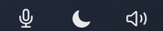
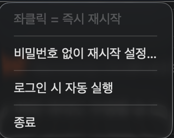

# 딸깍 (ttalkak)

[English](README.md) · 한국어

한 가지 일만 하는 macOS 메뉴 막대 앱 네 개. **좌클릭하면 바로 실행된다.** 메뉴가 안 뜬다.



| 앱 | 좌클릭하면 | 필요한 권한 |
| --- | --- | --- |
| **AudioFix** (오디오 재시작) — 느낌표 붙은 스피커 | `coreaudiod` 재시작 — 소리가 치직거리거나 출력 장치가 안 잡힐 때 | 관리자 암호 (1회 설정으로 생략 가능) |
| **ThemeToggle** (다크·라이트) — 반만 채운 원 | 시스템 외형 즉시 전환 | 자동화 (System Events) |
| **MicRecorder** (녹음) — 채운 마이크 | 녹음 시작 / 중지 | 마이크, 다운로드 폴더 |
| **ResourceBar** (리소스 모니터) — SSD 막대, GPU·CPU·메모리 그래프, 네트워크 속도 | 누른 위젯의 상세 창 | 없음 |

**우클릭**(또는 컨트롤+클릭)하면 설정 메뉴가 열린다.



아이콘이 곧 상태다. ThemeToggle은 현재 외형에 해당하는 쪽이 채워지고, AudioFix는 재시작하는 동안
순환 화살표가 되며, MicRecorder는 대기 중이면 마이크, 녹음 중이면 꽉 찬 빨간 점이다. 경과 시간과
안내 문구는 **툴팁과 우클릭 메뉴**에만 싣는다 — 메뉴 막대에 글자를 붙이면 아이콘이 밀려나 사라지기
때문이다. ([왜 그런지](docs/macos-notes.md#2-메뉴-막대가-꽉-차면-아이콘이-사라진다))

아이콘은 템플릿 이미지가 아니라 흑/백을 **직접 칠해서** 그린다. 메뉴 막대의 템플릿 이미지는 macOS가
자기 항목에 주는 밝기의 40% 정도로만 그려져서, Wi-Fi나 제어 센터 옆에 두면 우리 것만 흐릿해 보인다.
([왜 그런지](docs/macos-notes.md#13-템플릿-이미지는-시스템-아이콘보다-흐리게-그려진다))

네 앱 모두 우클릭 메뉴에 **메뉴 막대 오른쪽 끝에 고정** 토글이 있다. 항목이 넘치면 macOS는 왼쪽부터
지우기 때문에, 외장 모니터를 뺀 노치 맥에서 살아남는 자리는 제어 센터 옆 오른쪽 끝뿐이다. 켜면 지금
바로 그 자리로 옮기고 매 실행마다 유지하며, 끄면 켜기 전 자리로 되돌린다.

MicRecorder와 ResourceBar는 켠 채로 나온다. 안 보이는 녹음 표시는 쓸모가 없고, ResourceBar는 폭이
228pt라 노치 화면에서는 오른쪽 끝 말고 들어갈 자리가 없기 때문이다. 나머지 둘은 꺼져 있다.
꺼져 있는 동안에는 ⌘드래그로 평소처럼 옮길 수 있다.

---

## 요구 사항

- macOS 14.0 이상 (Apple Silicon)
- Xcode 명령줄 도구 (`xcode-select --install`)

## 빌드와 설치

```bash
git clone https://github.com/LeeKyuSung/ttalkak.git
cd ttalkak
bash build.sh                    # 전부
bash build.sh MicRecorder        # 하나만

for a in AudioFix ThemeToggle MicRecorder ResourceBar; do
  ditto "build/$a.app" "/Applications/$a.app" && open "/Applications/$a.app"
done
```

`/Applications` 밑에 두는 게 중요하다. `/private/tmp` 같은 데서 실행하면 macOS가 권한을 기억하지 못한다.

각 앱의 우클릭 메뉴에서 **로그인 시 자동 실행**을 켜면 부팅 후 자동으로 뜬다.

### 서명

`Apple Development` 인증서가 있으면 자동으로 찾아 쓴다. 없으면 ad-hoc 서명으로 넘어가는데, 이 경우
**소스를 고칠 때마다 권한(마이크·자동화)이 초기화된다.** ad-hoc 서명은 코드 해시가 곧 앱의 신원이라
한 글자만 바꿔도 macOS가 다른 앱으로 보기 때문이다.

번들 ID를 바꾸려면:

```bash
BUNDLE_PREFIX=com.example bash build.sh
```

### 제거

앱을 종료하고 `/Applications`에서 지우면 된다. AudioFix의 sudoers 설정을 했다면
[docs/sudoers.md](docs/sudoers.md#손으로-되돌리기)를 보고 함께 되돌린다. ResourceBar 기록은 홈 폴더의
`Library/Logs/ResourceBar`에 남으니 필요하면 함께 지운다.

---

## 권한

앱이 나뉘어 있어 권한도 앱별로 따로 허용해야 한다.

| 앱 | 권한 | 위치 | 언제 물어보나 |
| --- | --- | --- | --- |
| ThemeToggle | 자동화 → System Events | 설정 › 개인정보 보호 및 보안 › 자동화 | 첫 전환 클릭 |
| MicRecorder | 마이크 | 설정 › 개인정보 보호 및 보안 › 마이크 | 첫 녹음 클릭 |
| MicRecorder | 다운로드 폴더 | 설정 › 개인정보 보호 및 보안 › 파일 및 폴더 | 첫 저장 |
| AudioFix | 없음 (관리자 암호만) | — | — |
| ResourceBar | 없음 | — | — |

거부해도 조용히 실패하지 않는다. 해당 설정 화면으로 바로 가는 버튼이 붙은 안내가 뜬다.

마이크가 거부 상태로 굳어 설정에서 켜도 안 되면 한 번만:

```bash
tccutil reset Microphone kr.leekyusung.MicRecorder
```

---

## 녹음 파일

- 저장 위치: **`~/Downloads`**
- 파일명: `녹음_2026-08-14_101530.m4a` (같은 초에 겹치면 `-1`, `-2` … 접미사)
- 형식: AAC 모노 64 kbps `.m4a` — Whisper 계열에 그대로 넣을 수 있다

입력 장치는 우클릭 메뉴 › **입력 장치**에서 고르고 기억된다. 첫 실행 기본값은 **내장 마이크**다.
AirPods 같은 블루투스 기기를 입력으로 잡으면 HFP로 내려가 녹음 내내 출력 음질이 통화 수준으로 떨어진다.

안전장치:

- 녹음 중 앱을 종료하거나 로그아웃해도 파일을 정상 마무리한다 (안 하면 재생 불가 파일이 된다)
- 이어폰 연결이 끊겨도 그때까지 녹음된 부분은 재생 가능한 상태로 저장하고 원인을 알려준다
- 빠르게 두 번 눌러도 녹음이 두 개 생기지 않는다
- 녹음 중 1초마다 상태를 확인해, 문제가 생기면 경고음과 경고창을 띄우고 아이콘을 주황 삼각형으로 바꾼다
  - **기록 정지**: 파일에 기록되는 길이가 5초 넘게 늘지 않을 때. 경고창에서 바로 새로 녹음을 시작할 수 있다
  - **무음**: 입력이 20초 넘게 완전한 무음(-80 dBFS 이하)일 때. 음소거나 소리가 안 들어오는 장치를 의심한다
  - **끝난 뒤 확인**: 저장된 파일이 녹음한 시간보다 눈에 띄게 짧으면 알린다
  - 오류 없이 27분 녹음이 1.6초만 남은 일(2026-10-27)이 있어 넣었다
- 시작·문제 발생·종료를 시스템 로그에 남긴다: `log show --last 1d --predicate 'subsystem == "kr.leekyusung.MicRecorder"'`

---

## 리소스 모니터 (ResourceBar)

메뉴 막대 한 칸(228pt)에 왼쪽부터 SSD 사용률 막대, GPU·CPU·메모리 1분 그래프, 업로드·다운로드 속도를
그린다. 1초마다 갱신하고 권한이 필요 없다.

- **SSD**는 실제 사용률(`/System/Volumes/Data`의 `1 - f_bavail / f_blocks`)이다. macOS가 "비울 수 있다"고
  하는 공간을 여유로 치지 않아서, 일부 모니터처럼 숫자가 들쭉날쭉하지 않다. 막대는 80% 미만이면 파랑,
  80% 이상이면 주황, 90% 이상이면 빨강이다.
- **위젯을 좌클릭**하면 그 위젯의 상세 창이 열린다. SSD를 뺀 위젯은 5분 그래프가 나오고(SSD는 사용량
  한 줄), CPU·메모리·SSD는 많이 쓰는 프로세스 8개와 종료 버튼(확인 뒤 SIGTERM)이 나온다. 종료하면 그
  자리에서 로그아웃되는 `loginwindow`는 버튼을 꺼 둔다.
- **다른 계정의 프로세스**(root, `_windowserver` 등)는 일반 앱이 사용량을 읽을 수 없다. 그래서 CPU·메모리
  창이 열려 있는 동안 2초마다, 그리고 기록 줄을 남길 때 그 PID들만 `/bin/ps`로 받아 합친다. 그 줄은 *(시스템)* 표시가 붙고 종료할
  수 없다. `ps`는 활성 상태 보기의 footprint가 아니라 RSS를 줘서 메모리가 작게 나오고(WindowServer 107MB,
  활성 상태 보기 549MB), `kernel_task`는 `ps`에도 보이지 않는다.
- **기록**: CPU나 GPU가 80%를 10초 넘기거나 메모리 압박이 "경고"가 되면, 그 순간 많이 쓰는 프로세스를
  홈 폴더의 `Library/Logs/ResourceBar/spikes-YYYY-MM-DD.jsonl`에 JSON 한 줄로 남긴다. CPU·GPU·압박
  "위험"은 이어지는 동안 60초마다, "경고"만 있으면 10분마다 남긴다(경고가 평상시인 맥이 많다). 30일
  지난 파일은 지운다.
- **비용**: 같은 맥에서 같은 시간대에 [Stats](https://github.com/exelban/stats)와 함께 쟀다(화면 2대, 코어
  하나 기준). ResourceBar 약 1%, Stats 5.2%에서 6.0%. 메모리 13MB 대 201MB. CPU·메모리 상세 창을 열어
  둔 동안은 1.4에서 1.9%p가 더 들고, 그중 약 0.5가 `ps`다.
- 그리기 비용의 대부분은 그리기 자체가 아니다. 화면이 2대면 칸을 다시 그릴 때마다 AppKit이 그 칸을
  다른 화면용으로 다시 찍는다. 그래서 넓은 칸 하나가 좁은 칸 다섯 개보다 훨씬 싸다.

`--login-item on|off`로 메뉴를 거치지 않고 로그인 항목을 켜고 끌 수 있다(설치 스크립트용). 위 숫자를 잰
측정용 인자와 설계 메모는 [docs/resourcebar.md](docs/resourcebar.md)에 있다.

---

## 비밀번호 없이 오디오 재시작 (선택)

기본값은 클릭할 때마다 관리자 암호를 묻는다. AudioFix 우클릭 메뉴의 **"비밀번호 없이 재시작 설정…"**
을 직접 누르면 규칙 파일 하나가 생기고, 이후로는 클릭 한 번으로 끝난다. **자동으로 설치되지 않는다.**

허용되는 것은 `killall coreaudiod` 딱 하나다. 인자까지 정확히 일치해야 하므로 다른 프로세스를 죽이는 데
쓸 수 없다. 설치 전에 실제 스크립트를 확인할 수 있다.

```bash
/Applications/AudioFix.app/Contents/MacOS/AudioFix --print-installer
```

sudoers를 잘못 만지면 sudo를 못 쓰게 되므로 백업·검증·롤백을 겹겹이 뒀다.
자세한 설계와 되돌리는 법은 [docs/sudoers.md](docs/sudoers.md)에 있다.

---

## 왜 `launchctl`이 아니라 `killall`인가

SIP가 켜져 있으면(기본값) 시스템 데몬에 대한 `launchctl` 조작이 통째로 막힌다.

```text
sudo launchctl kickstart -kp system/com.apple.audio.coreaudiod
→ Could not kickstart service: 150: Operation not permitted while
  System Integrity Protection is engaged (150)
```

반면 root가 시그널을 보내는 것은 허용되고, `coreaudiod`는 launchd가 곧바로 되살린다.
AudioFix는 재시작 성공 여부를 **PID가 바뀌었는지**로 확인한다. 명령이 오류 없이 끝났어도 PID가 그대로면
"확인 불가"라고 알린다.

---

## 구조

```text
ttalkak/
├── Shared/Shared.swift          공통 — 프로세스 실행, 관리자 권한, 알림, 메뉴 막대 아이콘, 로그인 항목
├── AudioFix/AudioFix.swift
├── ThemeToggle/ThemeToggle.swift
├── MicRecorder/MicRecorder.swift
├── ResourceBar/                 ResourceBar.swift(진입점)와 값 읽기·상세 창·기록·그리기
├── build.sh
└── docs/
    ├── macos-notes.md           만들면서 부딪힌 macOS 제약들
    ├── resourcebar.md           ResourceBar 설계 메모와 측정
    └── sudoers.md               권한 설계와 되돌리는 법
```

의존성 없음. 각 앱은 `Shared.swift` + 자기 폴더의 파일(ResourceBar 말고는 한 개)을 `swiftc` 한 번으로 컴파일한다.
Xcode 프로젝트도 SwiftPM도 쓰지 않는다.

`Shared.swift`의 `StatusIcon`이 클릭 구분을 담당한다(ResourceBar는 아이콘이 아니라 직접 그린 칸이라
`AppController`에서 같은 방식으로 한다). 핵심은 `statusItem.menu`를 **평상시 비워 두는**
것이다 — 메뉴를 계속 달아 두면 좌클릭도 메뉴를 열어버려 "즉시 실행"이 사라진다.

---

## 문서

- **[docs/macos-notes.md](docs/macos-notes.md)** — SIP, 노치 뒤로 사라지는 아이콘, TCC와 코드 서명,
  파이프 교착, 녹음 파일 마무리 등 만들면서 부딪힌 것들
- **[docs/resourcebar.md](docs/resourcebar.md)** — ResourceBar 설계, 기록 규칙, Stats와 비교한 측정
- **[docs/sudoers.md](docs/sudoers.md)** — sudoers를 안전하게 건드리는 법

## 라이선스

MIT — [LICENSE](LICENSE)
