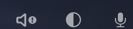
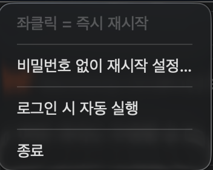

# ttalkak (딸깍)

English · [한국어](README.ko.md)

Three tiny macOS menu bar apps that each do exactly one thing. **Left-click acts immediately** — no menu
drops down, no confirmation.

*ttalkak* (딸깍) is the Korean onomatopoeia for a click.



| App | Left-click | Permissions |
| --- | --- | --- |
| **AudioFix** — speaker with a warning badge | Restarts `coreaudiod` — fixes crackling audio and output devices that won't connect | Admin password (can be waived, opt-in) |
| **ThemeToggle** — half-filled circle | Switches between Dark and Light appearance | Automation (System Events) |
| **MicRecorder** — filled microphone | Starts / stops recording | Microphone, Downloads folder |

**Right-click** (or control-click) opens a small settings menu.



The icon *is* the state. ThemeToggle fills the half of the circle that matches the current appearance;
AudioFix spins a refresh arrow while it restarts; MicRecorder is a microphone when idle and a solid red
dot while recording. Elapsed time and status messages live in the tooltip and the right-click menu
only — putting text in the menu bar widens the item, and a widened item gets pushed off the menu bar
entirely. ([why](docs/macos-notes.md))

The icons are drawn in an explicit black or white rather than as template images. A template image in the
menu bar is drawn at roughly 40 % of the strength macOS gives its own items, which makes a third-party
icon look washed out next to Wi-Fi and Control Center. ([why](docs/macos-notes.md))

Every app's right-click menu has a **Pin to the right end of the menu bar** toggle. When items overflow,
macOS drops the leftmost ones, so the right end — next to Control Center — is the only spot that survives
on a notched MacBook with no external display attached. Turning it on moves the icon there and keeps it
there on every launch; turning it off puts the icon back where it was before you pinned it.

MicRecorder ships with it on, because a recording indicator you cannot see is useless. The other two
default to off. ⌘-drag still works as usual while the toggle is off.

---

## Requirements

- macOS 14.0+ (Apple Silicon)
- Xcode command line tools (`xcode-select --install`)

## Build and install

```bash
git clone https://github.com/LeeKyuSung/ttalkak.git
cd ttalkak
bash build.sh                    # all three
bash build.sh MicRecorder        # just one

for a in AudioFix ThemeToggle MicRecorder; do
  ditto "build/$a.app" "/Applications/$a.app" && open "/Applications/$a.app"
done
```

Installing into `/Applications` matters. macOS will not remember privacy permissions for bundles that live
in places like `/private/tmp`.

Each app's right-click menu has a **Launch at login** toggle.

### Signing

The build script picks up an `Apple Development` certificate automatically if you have one. Without it, it
falls back to ad-hoc signing — in which case **every source edit resets the app's privacy permissions**,
because an ad-hoc signature's identity is just the code hash. You will re-approve the microphone prompt a
lot while hacking on it.

Use your own bundle identifier with:

```bash
BUNDLE_PREFIX=com.example bash build.sh
```

### Uninstall

Quit the apps and delete them from `/Applications`. If you enabled AudioFix's passwordless option, also
revert that — see [docs/sudoers.md](docs/sudoers.md) (Korean).

---

## Why `killall` and not `launchctl`

The obvious way to restart CoreAudio does not work when System Integrity Protection is enabled, which is
the default:

```text
sudo launchctl kickstart -kp system/com.apple.audio.coreaudiod
→ Could not kickstart service: 150: Operation not permitted while
  System Integrity Protection is engaged (150)
```

SIP blocks `launchctl` operations on `system/` domain daemons entirely, even for root. Sending a signal as
root is still allowed, and launchd brings `coreaudiod` straight back. So `sudo killall coreaudiod` is the
path that actually works.

Because `killall` only sends a signal, exit code 0 does not mean the daemon restarted. AudioFix confirms it
by checking that **the PID actually changed**, and says so honestly when it cannot confirm.

### Passwordless restart (opt-in)

By default every click asks for an admin password. The right-click menu offers to install a sudoers rule so
it does not — it is **never installed automatically**, since it waives sudo authentication.

The rule permits exactly one command, arguments included, so it cannot be used to kill anything else:

```text
Cmnd_Alias AUDIOFIX_KILL = /usr/bin/killall coreaudiod
<your-username> ALL=(root) NOPASSWD: AUDIOFIX_KILL, AUDIOFIX_PROBE
```

You can read the exact script before running it:

```bash
/Applications/AudioFix.app/Contents/MacOS/AudioFix --print-installer
```

Editing sudoers badly can lock you out of `sudo`, so the installer backs up `/etc/sudoers`, validates the
**assembled** configuration with `visudo -cf` (not just the fragment), and rolls back on any failure. It
also records whether it was the one that added the `@includedir` line, so uninstalling never removes a line
that was already there. Details in [docs/sudoers.md](docs/sudoers.md) (Korean).

---

## Recordings

- Saved to **`~/Downloads`**
- Named `녹음_2026-08-14_101530.m4a`, with a numeric suffix if a name collides
- AAC mono 64 kbps `.m4a` — feeds straight into Whisper-style transcription

Pick the input device from the right-click menu; the choice is remembered. The default is the **built-in
microphone** on purpose: selecting a Bluetooth headset as the input forces the HFP profile, which degrades
output audio to phone-call quality for as long as you are recording.

The recorder also:

- finalizes the file when the app quits or you log out, so it is never left unplayable
- keeps whatever was captured when the input device disappears mid-recording, and tells you why it stopped
- ignores a second click while a recording is still starting, so you never get two overlapping recordings

---

## Layout

```text
ttalkak/
├── Shared/Shared.swift          process exec, admin exec, alerts, status icon, login item
├── AudioFix/AudioFix.swift
├── ThemeToggle/ThemeToggle.swift
├── MicRecorder/MicRecorder.swift
├── build.sh
└── docs/
    ├── macos-notes.md           macOS constraints hit while building this
    └── sudoers.md               privilege design and how to undo it
```

No dependencies, no Xcode project, no SwiftPM. Each app is one `swiftc` invocation over `Shared.swift` plus
its own file.

The click behaviour lives in `StatusIcon`. The trick is keeping `statusItem.menu` **empty at rest** — if a
menu stays attached, a left-click opens it and the action never fires, which defeats the whole point.

---

## Notes

[docs/macos-notes.md](docs/macos-notes.md) is written in Korean and covers what actually cost time here: SIP
blocking `launchctl`, status icons silently banished behind the notch, TCC refusing the microphone because
of a missing entitlement rather than user choice, `do shell script` swallowing exit codes, pipe deadlock
when draining stdout and stderr in sequence, and losing an entire recording by not letting the file finalize.

## License

MIT — see [LICENSE](LICENSE)
